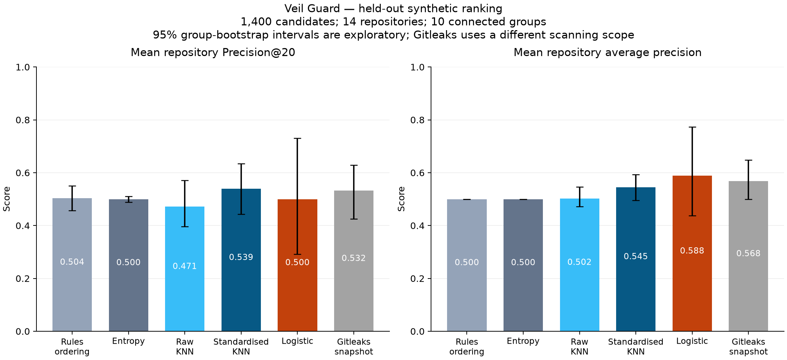
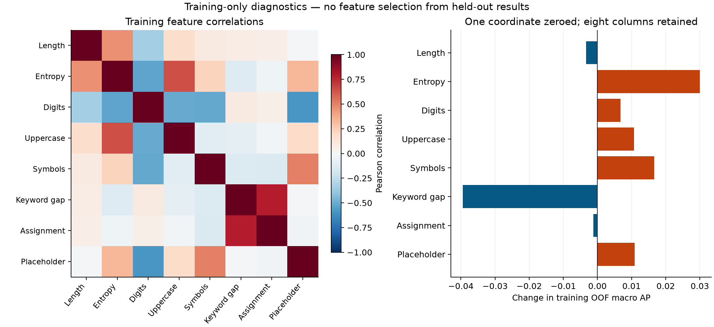

# Phase Four results — synthetic evidence only

Recorded 5 November 2026. The frozen [protocol](20-phase-four-protocol.md), [development artifacts](../research/results/synthetic-v1/development/freeze.json) and [evaluation seal](../research/results/synthetic-v1/evaluation/evaluation-seal.json) identify this experiment. Existing artifacts were audited and replayed when preparing this record; no model was refitted or selected after viewing test results.

Metric definitions follow the protocol’s use of [precision-recall evaluation, R13](13-sources.md#r13) and [average precision, R24](13-sources.md#r24). These references define methods; all numerical results below come from this project’s sealed artifacts.

## Decision

The prespecified KNN benefit gate **failed**. Standardised KNN achieved mean repository Precision@20 of 0.539286 versus entropy's 0.500000: a 7.857% relative improvement, below the required 10%. The paired absolute difference was 0.039286 with exploratory 95% connected-group bootstrap bounds [-0.053846, 0.132173]; the lower bound is not positive. This is not evidence of dependable improvement.

Validation found no abstention policy meeting both the 50% coverage and 20% accepted-error targets. The exported standardised model therefore reviews every candidate: test classification coverage is zero and accepted precision/recall/error are undefined. Ranking scores still exist; they are uncalibrated votes, not credential-validity probabilities. The native scanner remains rule-only.

## Population and comparisons

Training used 3,500 examples in 30 connected groups; validation used 1,100 in 10 groups. Held-out test comprised 1,400 examples (700 sensitive candidates, 700 benign), 14 repositories and 10 connected groups. Every test repository had 100 candidates. The 2,000 bootstrap replicates resample connected groups, retaining their repositories; intervals from ten synthetic groups are exploratory.

| Ordering | Mean repository Precision@20 | Mean repository AP |
| --- | ---: | ---: |
| Rules | 0.503571 | 0.500000 |
| Entropy | 0.500000 | 0.500000 |
| Raw KNN | 0.471429 | 0.502425 |
| Standardised KNN | 0.539286 | 0.545375 |
| Logistic | 0.500000 | 0.588427 |
| Gitleaks snapshot | 0.532143 | 0.567857 |

Gitleaks 8.30.1 used checksum-pinned embedded defaults on a staged-source directory snapshot. It matched 307 fixtures with `generic-api-key`. Its detection scope differs from native index scanning and generic review surfacing, so these figures do not establish a tool winner. Full intervals, slices, classification and skewed-subset diagnostics are in [evaluation.json](../research/results/synthetic-v1/evaluation/evaluation.json). The skewed subset reuses test examples and is not independent evidence.

Native extraction surfaced all 700 sensitive and all 700 benign test candidates, with no missing test fixture IDs. Source/index immutability and output redaction checks passed in the recorded run. This measures authored candidate surfacing, not valid-secret detection. The recorded 5.279 seconds includes fixture setup and is not a scanner latency benchmark. None of these fixtures exercised blocking patterns.

All 200 uncertain challenges remained review: 140 unsupported inputs and 60 eligible examples subject to the review-all policy. They have no binary ground truth; no challenge accuracy is claimed. There were 46 test exact-match conflicts and two inputs outside training support, illustrating representational limits.





## Reproduction and remaining work

From the repository root, with the pinned uv environment manager installed:

```sh
.venv/bin/uv run --locked --offline --project research/experiments python scripts/check_research.py
.venv/bin/uv run --locked --offline --project research/experiments python -m unittest discover -s research/experiments/tests -v
python3 scripts/check_all.py --offline
```

Figures were rendered from the sealed results with `research/experiments/plot_results.py`; they perform no fitting or selection.

The audit checks freeze/seal identities, train membership and preprocessing, selection consistency, and replays metrics from sealed predictions. It does not rerun external scanning or independently recompute every model prediction. The original finalisation command is defined in [run_experiment.py](../research/experiments/run_experiment.py); output directories must be new. Do not overwrite or tune against this held-out result.

Synthetic authoring, balanced prevalence, feature collisions, narrow extraction, pending corpus licensing and pending independent human label review limit any release claim. Phase Five can implement optional native experimental inference against the frozen export, with strict validation and Python/Rust parity. It must preserve deterministic findings and the failed-benefit disclosure. A new research hypothesis needs fresh independent evaluation data.
